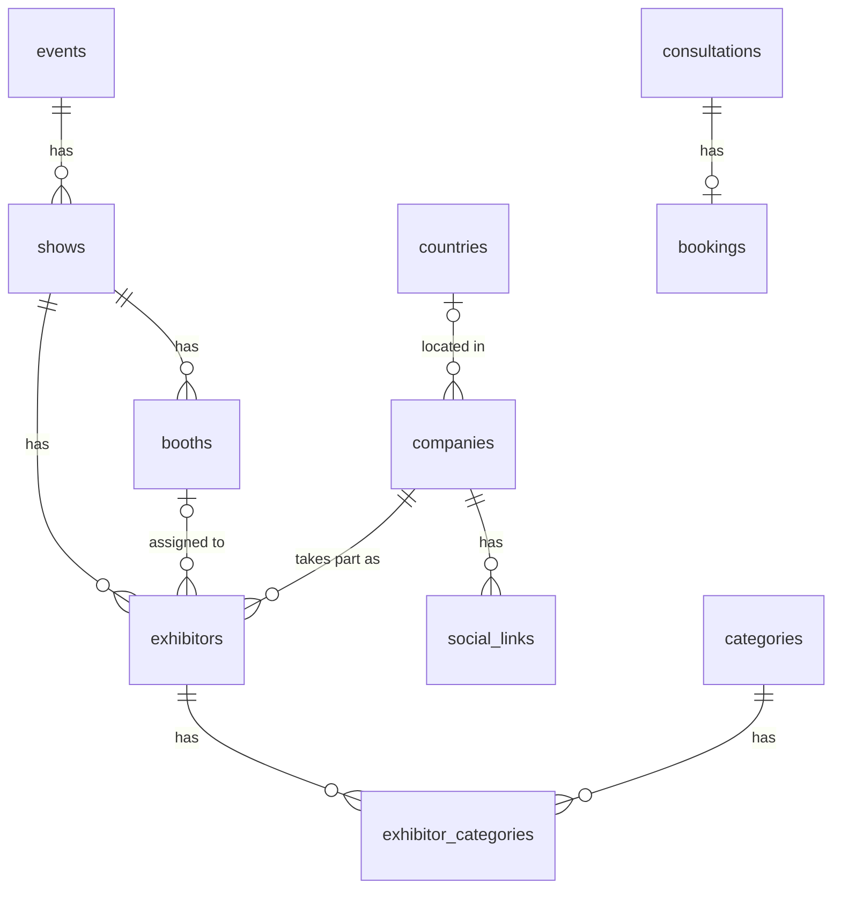

# Hubble by Cavli Wireless

A Next.js landing page for Hubble, with product pages that include a 3D viewer, a Consult Now booking flow with Google Meet, and an exhibitor scraper. All parts share one PostgreSQL database.

## Demo

**Live site:** https://hubble-cavli.vercel.app

The C41QS page uses the 3D model from the brief. The other four product pages use each module's own model from Cavli's website, loaded the same way.

## Getting started

### With Docker Compose

Requires Docker.

```bash
cp .env.example .env    # fill in SCRAPE_SECRET, Google and Gmail values
docker compose up --build
```

This starts PostgreSQL, runs the migrations and serves the app at http://localhost:3000. Compose sets `DATABASE_URL` itself, so you can leave that line in `.env` as it is.

### Without Docker

Requires Node.js 24 and PostgreSQL.

```bash
cp .env.example .env    # set DATABASE_URL to your database, then the other values
npm install
npm run db:deploy       # apply migrations
npm run dev
```

The app runs at http://localhost:3000.

### Environment variables

| Variable                                                                                 | Used for                                          |
| ---------------------------------------------------------------------------------------- | ------------------------------------------------- |
| `DATABASE_URL`                                                                           | PostgreSQL connection                             |
| `SCRAPE_SECRET`                                                                          | Protects the scraper endpoint (min 16 characters) |
| `GOOGLE_CLIENT_ID`, `GOOGLE_CLIENT_SECRET`, `GOOGLE_REFRESH_TOKEN`, `GOOGLE_CALENDAR_ID` | Calendar event and Meet link for bookings         |
| `GMAIL_USER`, `GMAIL_APP_PASSWORD`                                                       | Sends the confirmation email                      |

## Triggering the scraper

```bash
curl -X POST http://localhost:3000/api/scrape/exhibitors \
  -H "x-scrape-secret: YOUR_SCRAPE_SECRET"
```

The endpoint returns `202` straight away and the scrape runs in the background, which takes a few minutes. Check its progress with:

```bash
curl http://localhost:3000/api/scrape/exhibitors
```

Running it again updates existing rows instead of creating duplicates. While a scrape is running the endpoint returns `409`, and for 5 minutes after a successful run it returns `429` (`SCRAPE_COOLDOWN_SECONDS`).

For the live site, replace `http://localhost:3000` with `https://hubble-cavli.vercel.app`. Its secret is shared separately.

## Database

12 tables in PostgreSQL. Tables 1–9 hold scraped exhibitor data, table 10 logs scraper runs, and tables 11–12 hold Consult Now submissions.



### Tables

**1. `events`**: the trade fair as listed on MMI Connect (`ep-blr-2026`).

| Column | Notes  |
| ------ | ------ |
| `id`   | PK     |
| `slug` | Unique |

**2. `shows`**: the shows inside an event (electronica India, productronica India).

| Column                         | Notes                   |
| ------------------------------ | ----------------------- |
| `id`                           | PK, MMI Connect show id |
| `event_id`                     | FK → `events`           |
| `name`, `starts_at`, `ends_at` |                         |

**3. `booths`**: a booth at a show.

| Column    | Notes                              |
| --------- | ---------------------------------- |
| `show_id` | PK (with `code`), FK → `shows`     |
| `code`    | PK (with `show_id`), e.g. `H5.F95` |
| `hall`    |                                    |

**4. `countries`**

| Column | Notes  |
| ------ | ------ |
| `id`   | PK     |
| `name` | Unique |

**5. `companies`**: one row per company, however many shows it exhibits at.

| Column                                                           | Notes                          |
| ---------------------------------------------------------------- | ------------------------------ |
| `id`                                                             | PK                             |
| `mmi_user_id`                                                    | Unique, MMI Connect company id |
| `name`, `website`, `logo_url`, `profile`                         |                                |
| `address_line1`, `address_line2`, `city`, `state`, `postal_code` |                                |
| `country_id`                                                     | FK → `countries`, nullable     |
| `created_at`, `updated_at`                                       |                                |

**6. `social_links`**

| Column       | Notes                                          |
| ------------ | ---------------------------------------------- |
| `id`         | PK                                             |
| `company_id` | FK → `companies`                               |
| `platform`   | `LINKEDIN`, `TWITTER`, `FACEBOOK` or `YOUTUBE` |
| `url`        |                                                |

Unique on (`company_id`, `platform`).

**7. `exhibitors`**: a company taking part in one show.

| Column                     | Notes                                               |
| -------------------------- | --------------------------------------------------- |
| `id`                       | PK                                                  |
| `mmi_customer_id`          | Unique, MMI Connect exhibitor id (the upsert key)   |
| `company_id`               | FK → `companies`                                    |
| `show_id`                  | FK → `shows`                                        |
| `booth_code`               | FK (`show_id`, `booth_code`) → `booths`, nullable   |
| `last_seen_at`             | Last successful scrape that returned this exhibitor |
| `created_at`, `updated_at` |                                                     |

Unique on (`company_id`, `show_id`).

**8. `categories`**: product and sector categories.

| Column                                  | Notes                       |
| --------------------------------------- | --------------------------- |
| `id`                                    | PK, MMI Connect category id |
| `type`                                  | `SECTOR` or `EXHIBITOR`     |
| `main_category`, `name`, `sub_category` |                             |

**9. `exhibitor_categories`**: links exhibitors to categories (many-to-many).

| Column         | Notes                                       |
| -------------- | ------------------------------------------- |
| `exhibitor_id` | PK (with `category_id`), FK → `exhibitors`  |
| `category_id`  | PK (with `exhibitor_id`), FK → `categories` |

**10. `scrape_runs`**: one row per scraper run.

| Column                                                                     | Notes                            |
| -------------------------------------------------------------------------- | -------------------------------- |
| `id`                                                                       | PK                               |
| `status`                                                                   | `RUNNING`, `SUCCESS` or `FAILED` |
| `started_at`, `finished_at`                                                |                                  |
| `pages_fetched`, `exhibitors_found`, `exhibitors_saved`, `detail_failures` |                                  |
| `error_message`                                                            |                                  |

**11. `consultations`**: every Consult Now submission (`POST /api/consult`).

| Column                     | Notes                           |
| -------------------------- | ------------------------------- |
| `id`                       | PK                              |
| `name`, `email`, `message` |                                 |
| `phone`, `company`         | Nullable                        |
| `status`                   | `PENDING`, `BOOKED` or `FAILED` |
| `created_at`, `updated_at` |                                 |

**12. `bookings`**: the time slot picked for a consultation.

| Column                         | Notes                                                   |
| ------------------------------ | ------------------------------------------------------- |
| `id`                           | PK                                                      |
| `consultation_id`              | Unique, FK → `consultations` (at most one booking each) |
| `starts_at`                    | Unique, so a slot can't be booked twice                 |
| `ends_at`                      |                                                         |
| `google_event_id`, `meet_link` | From Google Calendar                                    |
| `confirmation_sent_at`         | When the confirmation email was sent                    |
| `created_at`                   |                                                         |

### Normalization (3NF)

- **1NF:** every column holds a single value. Repeating data gets its own rows instead of extra columns or lists: social links in `social_links`, categories through `exhibitor_categories`.
- **2NF:** the tables with composite keys have no partial dependencies. In `booths`, `hall` depends on the whole key (`show_id`, `code`), not on either part alone. `exhibitor_categories` has no columns outside its key.
- **3NF:** no column depends on another non-key column. Each fact is stored once, in the table it describes:
  - Company details live in `companies`, not on each exhibitor row, because one company can exhibit at both shows (807 companies, 814 exhibitors).
  - `hall` lives in `booths`, not `exhibitors`, because it belongs to the booth.
  - Show names and dates live in `shows`, and country names in `countries`.
  - `bookings` is separate from `consultations` because slot, event and Meet fields exist only after a slot is booked.

**Where I stopped short of 3NF:**

- `city`, `state` and `postal_code` stay as text on `companies`. The source data is too inconsistent to build reliable lookup tables.
- The category labels (`main_category`, `name`, `sub_category`) stay as MMI Connect provides them on each category row.

## Project structure

A single Next.js app serves both the frontend and the backend: Route Handlers serve the API, and Server Components read the database directly.

### Backend

| Path                       | Contents                                                    |
| -------------------------- | ----------------------------------------------------------- |
| `src/server/`              | Server-only code, guarded by `server-only`                  |
| `src/server/db.ts`         | Shared Prisma client                                        |
| `src/server/env.ts`        | Environment variable validation                             |
| `src/server/repositories/` | Database queries                                            |
| `src/server/scraper/`      | MMI Connect scraper: auth, fetching, validation and upserts |
| `src/app/api/`             | Route Handlers (`/api/*` endpoints)                         |
| `prisma/`                  | Database schema and migrations                              |
| `src/generated/prisma/`    | Generated Prisma client                                     |

### Frontend

| Path              | Contents                                                            |
| ----------------- | ------------------------------------------------------------------- |
| `src/app/`        | Pages, root layout and global styles                                |
| `src/layouts/`    | Page layouts (header, footer)                                       |
| `src/modules/`    | Feature modules (`home`, `product`, `consult`) and their components |
| `src/components/` | Reusable UI components                                              |
| `public/`         | Static assets                                                       |

### Shared

| Path          | Contents         |
| ------------- | ---------------- |
| `src/consts/` | Constants        |
| `src/types/`  | TypeScript types |
| `src/utils/`  | Helper functions |

Server Components may import from `src/server/` directly; Client Components must not.
